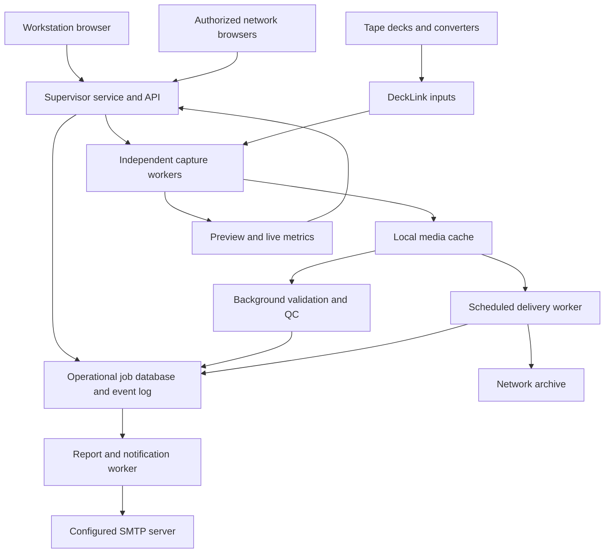
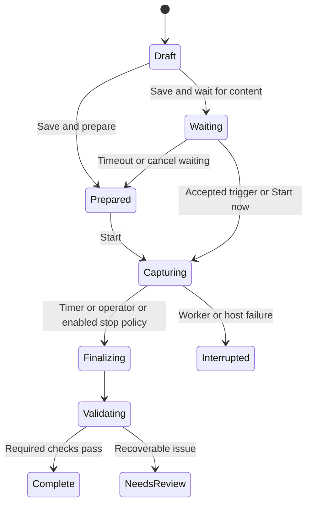

# DeckCapture Design and Implementation Plan

Planning baseline: October 30, 2026. Project name: **DeckCapture**.

Build a Windows application that supervises independent tape capture channels, records preservation files to a temporary local cache, performs recording QC, and delivers verified packages to station-managed storage under a configurable schedule. Use the same browser interface at the capture workstation and on authorized computers on the station network. Capture must continue when the browser closes, the network share becomes unavailable, or email delivery fails. The application manages capture jobs and delivery history; permanent archive storage, collection cataloging, asset search, and retrieval remain with the station's existing systems.

This first deliverable defines the design, operating rules, implementation sequence, and acceptance criteria. It does not include a capture application. The initial sizing assumption is one workstation and up to four simultaneous SDI inputs, with additional cards and workstations supported through the same channel model after validation.

# Recommended decisions

| Decision | Proposed baseline | Reason |
| --- | --- | --- |
| Capture location | Always record the master to local storage | A congested or unavailable share must not interrupt a tape capture. |
| Main application | Windows service with a browser interface | One authoritative controller serves both local and remote operators. |
| Capture isolation | One worker process per active input | A failed encoder or channel should not bring down other recordings. Shared card or driver failures remain a common risk. |
| Preservation profile | FFV1 version 3 in Matroska, 10-bit 4:2:2 when supported, PCM audio | Preserve the input without a lossy video generation. Validate compatibility with the station archive before locking this profile. |
| End detection | Experimental feature, disabled by default | Enable explicitly in settings. Begin with alerts; automatic stopping additionally requires a calibrated deck profile and per-job selection. |
| Start detection | Explicitly armed content trigger with pre-roll | Prevent accidental starts and retain the beginning while the detector confirms content. |
| Delivery | Copy, verify, publish, retain locally | File transfer completion alone must not authorize deletion of the capture. |
| Network paths | Store UNC destinations such as `\\archive-server\VideoArchive` | Windows services do not inherit an operator's mapped drive letters. |
| First implementation | One capture host, embedded local database, modular workers | Keep deployment manageable while preserving clear boundaries for expansion. |

FFV1 in Matroska is an established preservation format; the Library of Congress describes it as preferred for file-based video. That supports evaluating it here, but the station's downstream tools still determine the final delivery profiles. [Library of Congress format description](https://www.loc.gov/preservation/digital/formats/fdd/fdd000343.shtml)

# Hardware feasibility and compatibility

The DeckLink Duo 2 provides four independently configurable 3G-SDI connections, supports SD and HD up to 1080p60, and uses PCIe generation 2 x4. The published specifications list Windows support and up to 16 embedded audio channels. Four BNC connectors do not provide four inputs plus four additional outputs: each connector has an assigned direction. [Blackmagic Design specifications](https://www.blackmagicdesign.com/products/decklink/techspecs/W-DLK-31)

Treat the original DeckLink Duo as a separate compatibility target. Enumerate its capabilities and validate the exact card, driver, Windows version, and input formats before promising channel counts or compatibility. Do not infer its topology from the Duo 2 name.

The DeckLink SDK supports Windows. The capture worker should query device capabilities and retain persistent device identifiers, subdevice identifiers, connector assignments, and tested format support. Display a human label such as `Channel 2 — Betacam deck — Card A BNC 3`; never depend only on enumeration order. Profile changes can affect paired subdevices, so prevent changes affecting an active channel. [SDK operating system support](https://sdk-doc.blackmagicdesign.com/decklink-sdk/section1.html), [FFmpeg DeckLink profile notes](https://ffmpeg.org/ffmpeg-devices.html#decklink)

During the hardware validation phase:

1. Inventory card models and serials, available PCIe lanes, deck models, SDI outputs, and any external converters or time base correctors.
2. Validate each needed mode: NTSC/PAL SD, 720p, 1080i, 1080p, or PsF as applicable. Distinguish 29.97 frames/s from 59.94 fields/s.
3. Check embedded audio counts and ordering, 48 kHz sampling, source bit depth, audio/video alignment, timecode, and captions or ancillary data.
4. Observe each deck while stopped, playing leader, playing black, encountering a dropout, reaching blank tape, and physically reaching its end. Record whether it outputs black, blue, bars, a frozen image, or loses SDI lock.
5. Identify supported transport interfaces. Plan for a separate compatible RS-422 adapter where needed; do not assume a Duo-family card supplies a deck-control port.
6. Test the full simultaneous workload, including transfer reads, verification reads, previews, and background QC. Slot shape and nominal disk bandwidth alone are insufficient evidence.

For analog sources, the deck and conversion chain must provide a stable SDI signal. Software cannot recover information already lost by an unstable deck or converter. Keep a known test tape and a known reference recording for commissioning and later regression checks.

# Application architecture



| Component | Proposed implementation | Responsibilities |
| --- | --- | --- |
| Supervisor | C# and ASP.NET Core on .NET 10 LTS, installed as a Windows service | Channel configuration, job lifecycle, scheduling, access control, audit history, APIs, and worker supervision. |
| Interface | React and TypeScript | Shared accessible interface for the workstation and remote browsers. A later desktop wrapper can open this same interface if needed. |
| Capture worker | C++ with the DeckLink SDK and a pinned media encoding pipeline | Own the hardware input; capture synchronized audio/video; write the master; generate bounded monitoring data. |
| Media tools | Pinned and tested FFmpeg/ffprobe, plus qcli or equivalent validated tooling | Encoding, media inspection, access derivatives, and interoperable QC reports. |
| Durable job database | SQLite in WAL mode on local disk | Jobs, configuration versions, queue state, manifests, alerts, report outbox, and restart reconciliation. |
| Delivery worker | Separate supervised process | Resumable transfer, bandwidth limits, verification, retries, and safe publication. |
| QC and reports | Background workers | Expensive analysis and reporting with resource limits that protect active recordings. |

.NET 10 is an LTS release; pin a supported patched release during implementation. [Microsoft support policy](https://dotnet.microsoft.com/en-us/platform/support/policy/dotnet-core)

The native worker owns each input continuously while monitoring or armed. Recording, preview, scopes, and detection consume that worker's frames; separate programs must not compete to open the same input. Keep hardware callbacks short: retain or copy the frame into a bounded queue and return. Perform encoding, file writes, and analysis outside the callback.

Pass control and status over authenticated local named pipes. Keep raw video inside the capture worker unless measurements justify shared memory. Use bounded buffers throughout. If preview or scopes fall behind, discard their old updates. If the preservation writer falls behind, record the loss as a capture error and raise an alert; never silently report success.

Detect and confirm the input mode before arming, then lock the recording profile. An unexpected format change during capture raises an alert and safely finalizes the current file where possible. Start a new segment only under an explicitly configured and tested policy; do not silently rescale or change the format within a preservation file.

Use REST for commands and queries, with SignalR or equivalent pushed state updates for all browsers. Reconnecting browsers load a fresh snapshot before applying subsequent events. The service remains authoritative when a browser sleeps or disconnects. A separate health indicator must reveal stale data.

An initial FFmpeg DeckLink capture adapter is a reasonable feasibility shortcut if it exposes the needed status and metadata. FFmpeg requires a DeckLink-enabled build with the SDK; an ordinary Windows download cannot be assumed to include it. The FFmpeg installation examined during planning did not list the DeckLink device. Select the production adapter after the hardware spike proves capture, metadata, and signal-loss behavior. [FFmpeg DeckLink build requirements](https://ffmpeg.org/ffmpeg-devices.html#decklink)

# Operator interface and workflow

Use six main views: **Channels**, **Recording**, **Delivery queue**, **Recording QC and recent jobs**, **Alerts and reports**, and **Settings**. The Channels view opens by default. Recent jobs provide operational capture, review, and delivery history rather than a searchable archive catalog. Display labels with status colors, keyboard focus, accessible form labels, adequate contrast, and touch targets. Every status remains understandable without color or audio.

## Channels view

Each channel card displays its deck and connector, preview, input lock and detected format, audio meters, state, file name, operator, elapsed and remaining time, and warnings. A top strip shows active captures, local space and reserved space, estimated recording time remaining, queued bytes, current transfer rate, and the next transfer window.

Selecting a card opens its recording controls. During recording, retain a large remaining-time display and clear **Stop and save** and **Add time** actions. Stopping always finalizes the file. Deleting a retained local capture is a separate job-history action with separate permission.

## Prepare a recording

1. Select a channel.
2. Enter a file name. Show only the descriptive metadata fields enabled in settings, such as source station, operator, tape ID, barcode, batch, title, or notes. No tape identifier is required for ordinary recording.
3. Select a destination profile and folder on the archive server. Show both the local capture location and the final delivery destination.
4. Select a duration preset, for example 15, 30, 60, 90, or 120 minutes, or enter a custom duration. Presets are configurable globally and optionally per deck profile.
5. Select the preservation profile, audio mapping, and detection profile from approved presets.
6. Choose **Save and prepare** or **Save and wait for content**.

**Save and prepare** validates the job and displays a prominent **START RECORDING** button. It does not start the deck automatically. When a supported deck-control adapter is configured, expose **Play deck and record** as a distinct action.

**Save and wait for content** arms the selected input and shows the trigger condition, wait timeout, and **Start now** and **Cancel waiting** actions. The timer begins at the accepted content trigger. A finite maximum recording duration is mandatory for unattended operation. A proposed five-second pre-roll is additional to the selected duration, so a 60-minute triggered recording may contain up to 60 minutes and five seconds. Show that clearly and reserve storage accordingly.

After capture, show a result card with stop reason, actual duration, integrity and QC status, local file location, and delivery state. Retain only approved defaults for visible metadata fields, and clear unique tape IDs and barcodes for the next job. Hidden fields do not add clutter or carry stale values into new captures.

## Configurable recording fields

Settings provide one visibility control per descriptive field. File name, duration, channel, and destination remain core recording controls; file names may use a configured automatic pattern. Tape IDs and other descriptive values are not required for basic capture.

| Field | Initial visibility | Behavior |
| --- | --- | --- |
| File name | Always shown | Required or generated automatically; independent of a tape ID. |
| Source station | Shown | Optional descriptive value. Destination choice remains independent. |
| Operator display name | Shown | Optional entry; authenticated control actions retain their normal audit identity. |
| Tape ID | Hidden | Optional source reference. |
| Barcode | Hidden | Optional keyboard-scanner input. |
| Batch label | Hidden | Optional report-group label; operational grouping also works without it. |
| Collection | Hidden | Optional text passed to the destination as metadata. |
| Title | Hidden | Optional descriptive title. |
| Description | Hidden | Optional summary. |
| Notes | Hidden | Optional operator notes. |

A hidden field is absent from the capture form and cannot be required. Do not silently carry a hidden default into a new recording's descriptive metadata. Earlier jobs retain their captured metadata. Save field settings in configuration export/import and include the effective field definitions in each prepared job snapshot. Validate naming and destination templates so they do not depend on hidden optional fields. Hiding a field is a layout and collection choice, not a deletion or access-control mechanism.

## Destination selection

A remote browser's file picker cannot select arbitrary folders on the capture host or archive server. Implement a server-side folder browser confined to administrator-configured archive roots. Translate a workstation drive label to its configured UNC location during setup. If the share is offline, allow a previously saved destination or a validated relative folder beneath an approved root and mark it for later revalidation.

Use a service identity with appropriate share and NTFS permissions. Test reachability and write permissions as that identity. Windows services should use UNC names because mapped drive letters belong to individual logon sessions. [Microsoft guidance on services and redirected drives](https://learn.microsoft.com/en-us/windows/win32/services/services-and-redirected-drives)

## Prevent conflicting controls

Allow multiple viewers. Give an operator a visible, expiring control lease for a channel; an authorized supervisor can take it over. Commands carry an idempotency key and expected job version so double clicks or two browsers cannot start duplicate recordings. Enforce one active recording per physical input. Metadata and destination changes after arming require an explicit revision and revalidation.

# Capture files and preservation metadata

The default candidate is FFV1 version 3 in Matroska with slice checksums and PCM audio, retaining the actual source bit depth and approved audio channels. Benchmark encoding throughput with noisy tapes; do not estimate a workstation's capacity from clean color bars alone. Offer a tested uncompressed v210 profile when required, and an agreed production interchange profile only after testing the station's editing and archive systems.

Retain source raster, frame rate, interlace or PsF properties, field order, aspect ratio, and color metadata. Avoid automatic crop, deinterlace, scaling, noise reduction, or audio normalization in the preservation master. Use separate preview or access derivatives for those operations. In particular, do not silently turn a captured 486-line raster into 480 lines. Correctly label SD and HD color characteristics and verify field order using known material.

Store each recording as a package with a stable job identifier:

```text
STATION_TAPEID_20261030_001/
  STATION_TAPEID_20261030_001.mkv
  metadata.json
  capture.log
  events.jsonl
  checksums.sha256
  qc-summary.json
  timecode.jsonl                 when available
  captions/                     when available
  report.qctools.xml.gz         when enabled and supported by the pinned qcli
  access.mp4                    optional
  COMPLETE.json                 published only after required files verify
```

Automatic technical metadata includes an internal capture UUID, channel and hardware identity, deck profile, UTC capture timestamps, time zone, requested and actual duration, frame and audio counts, source timecode discontinuities, detected format, encoding profile and tool versions, configuration version, stop reason, signal-loss events, dropped-frame indicators, hashes, QC state, and chosen destination. Operator-entered metadata such as tape ID, station, operator display name, barcode, batch, title, description, collection, or notes is individually configurable and optional by default. Record only enabled, populated descriptive fields in a new job. Hiding a field does not remove values from earlier recordings. Save selected descriptive fields inside the media container where supported and keep the full sidecar authoritative.

Capture timecode frame by frame when available; a first-frame timecode tag cannot describe later breaks. Explore preservation of captions, VBI/VANC, and other ancillary packets as an explicit hardware acceptance item. SDI video capture alone does not guarantee that these survive. Never enable a wait-for-timecode option that discards the opening content without making that behavior explicit.

Write growing media under an incomplete name or in an incomplete local package. On stop, drain the writer, finalize the container, close files, inspect streams and duration, and generate checksums. Finalization or validation failures produce **Needs review** or **Failed**, not a green completion status. Reconcile orphaned files after a crash and preserve the original bytes before attempting repair. A crash-recovered recording remains **Interrupted** until checked.

Separate capture success, signal-quality findings, and delivery success. A dark program can have a valid capture with a black-content warning. A file can be correctly copied while still needing editorial review. Neither a matching checksum nor a clean decode proves that no source frames were missed during capture.

# Timers and tape detection

## State model



Track delivery and QC as separate lifecycles, not extra mutually exclusive capture states. A channel can prepare another tape while its previous job is being analyzed or delivered.

Use a monotonic clock for elapsed duration and source timestamps or sample counters for media duration. Keep these separate from wall-clock timestamps and tape timecode. A clock correction or a discontinuous tape timecode must not extend or prematurely finish a recording. Use rational frame rates such as 30000/1001. Define duration boundaries to the nearest supported frame, and test 29.97 material explicitly.

## What detection can establish

Extended black can indicate blank tape, but it can also be intentional program material. Decks may output blue, bars, frozen frames, or a stable black SDI signal at tape end. End-of-tape inference is therefore experimental and disabled by default. When enabled, begin with a **Suspected tape ending** alert policy. Automatic stopping is an additional per-job choice for a calibrated deck profile. FFmpeg provides black and freeze analysis that can support the detector. DeckLink separately marks frames with no input source; distinguish these invalid frames from valid black content. [FFmpeg analysis filters](https://ffmpeg.org/ffmpeg-filters.html#blackdetect), [DeckLink frame flags](https://sdk-doc.blackmagicdesign.com/decklink-sdk/DeckLinkAPI/enums/bmdframeflags.html)

## Proposed deck detection profiles

| Control | Starting value for a test profile | Rule |
| --- | --- | --- |
| Experimental end detection | Disabled globally | Enabling applies to newly prepared jobs. Disabling inhibits experimental alerts and stops on current jobs and cancels any pending stop countdown. |
| Enabled end detection mode | Alert only | Automatic stop requires explicit per-job selection and a validated deck profile. |
| Minimum recording before end detection | 5 minutes | Avoid treating initial leader as the end. Configurable for short tapes. |
| Black coverage | At least 99 percent of the analysis region | Calibrate for the actual range and noise floor. |
| Black pixel level | Example equivalent of 8-bit limited-range luma 24 | Translate correctly for full range and 10-bit inputs; do not reuse a raw threshold across formats. |
| Silence condition | Example RMS below -50 dBFS on selected program tracks | Require both black and silence for the conservative profile. Ignore intentionally unused audio tracks. |
| Continuous end condition | 120 seconds | Reset on meaningful content; calibrate tolerance for isolated noise. |
| Stop grace period | 30 seconds | When automatic stop is enabled, visibly count down; content return cancels it. |
| No signal | Alert and continue to timer by default | A cable fault or dropout is not a confirmed tape ending. Record invalid intervals. |
| Start confirmation | 2 seconds of stable valid input plus accepted content | Require explicit arming and preserve pre-roll. |
| Maximum wait for content | 15 minutes | Alert and return to Prepared after timeout; do not create a successful empty recording. |
| Pre-roll | 5 seconds while armed | Keep bounded synchronized video and audio before the trigger. |

These numbers are proposed calibration values, not universal thresholds. Analyze a configurable picture region so head-switching noise, borders, or ancillary lines do not dominate detection; preserve the full source raster in the master. The global experimental switch is the master disable control. When enabled, each newly prepared job can select Off, Alert only, or Stop after detection. Enabling the feature never silently activates it on an already prepared or recording job. Fixed duration timers and content-triggered starts remain available with experimental end detection disabled. Offline QC may still report black intervals independently.

Define content-trigger behavior explicitly. Do not trigger on loss of lock, device-generated replacement frames, or configured idle blue/bars. If content is already present when arming, default to waiting for a new accepted transition and offer **Start now**. A deck Play status transition can be a better start signal when a reliable transport adapter exists. Static slates and dark or silent openings must be included in calibration; image analysis cannot guarantee that all valid content is recognized.

The hard timer takes precedence over a detection grace period. Automatic stopping retains the trailing captured black; do not automatically trim or overwrite the preservation file. Save detection intervals and the exact stop reason. Re-arming after completion is an explicit operator action so the same tape cannot repeatedly trigger new files.

# Scopes and quality control

Borrow the preservation workflow concepts from vrecord: approved capture presets, operator metadata, a preparation step, timed recording, capture logs, integrity data, and interoperable QC output. vrecord itself currently targets macOS and Linux, so use it as a workflow reference rather than making its shell interface the Windows supervisor. [vrecord project](https://github.com/amiaopensource/vrecord), [vrecord recording options](https://github.com/amiaopensource/vrecord/blob/main/Resources/Documentation/settings.md)

## Live monitoring

Provide picture preview, per-track peak and RMS audio meters, luma waveform, chroma vectorscope, RGB parade or histogram, field inspection, out-of-range highlighting, input-lock state, timecode, writer buffer occupancy, and dropped-frame warnings. Include optional stereo phase or correlation and audio spectrogram views after the core views work reliably.

Compute quantitative scopes and detection from source samples or a documented analysis path, not a browser-compressed preview. Show when a scope is sampled or reduced in resolution. Preview deinterlacing must not modify the master. Bound preview resolution, update rate, client count, and analysis workload; degrade monitoring before it affects recording.

## Background QC

After finalization, inspect stream structure, format conformity, decode errors, duration, audio/video alignment, timecode continuity, black and silence intervals, frozen picture, and selected source-quality indicators. Build a time-aligned review graph with clickable event markers and an access-quality playback view. Show frame and field views where appropriate.

QCTools documents luma/chroma statistics, temporal outliers, vertical line repetition, and broadcast-range analysis. Treat those metrics as review indicators, with profiles per tape format, rather than definitive diagnoses. Preserve out-of-range samples in the master instead of clipping them to satisfy an alarm. [QCTools filter descriptions](https://bavc.github.io/qctools/filter_descriptions.html)

Prefer generating an actual QCTools-compatible report through a pinned qcli tool instead of inventing a vaguely similar report format. Its documented CLI can create compressed XML reports; validate the selected Windows build and round-trip opening in the QCTools version used by staff. Internal live metrics and full offline QC have different accuracy and workload requirements. [QCTools CLI documentation](https://github.com/bavc/qctools#using-qcli)

Validate the file and required package members before normal delivery. Optional expensive QC can run later if the configured policy permits it, with a separate supplemental report package and updated job-history state. Do not modify a media file after hashing it. Define which sidecars are required in a configuration snapshot so delivery does not wait indefinitely for an optional process.

# Local storage and delivery queue

## Capture reservations

Before arming, reserve enough local capacity for the maximum duration, pre-roll, required sidecars, temporary files, and safety margin. Sum reservations for all active and armed channels. Use measured high-end data rates and a conservative fallback; FFV1 size varies with source noise. Monitor actual write rate and projected time to full throughout capture.

Proposed operating policy: warn at a configurable free-space threshold, refuse new captures when unreserved capacity is insufficient, and stop admitting new work before emergency reserve is reached. If an active capture is about to exhaust its allocation, alert and gracefully finalize while space remains. Never delete an undelivered or unverified recording to free space.

Keep production database and media paths on dedicated local volumes outside OneDrive and other desktop sync folders. Define a recoverable database backup procedure, controlled application updates, and a retention policy. A verified copy on one network share is a delivery result; long-term preservation still requires the station's backup and redundancy policy.

## Scheduling rules

The following example is a conservative initial profile to tune with station IT:

| Setting | Example |
| --- | --- |
| Transfer window | Every day 10:00 p.m. to 6:00 a.m. |
| Time zone | America/Chicago, stored with a supported Windows mapping |
| Simultaneous file transfers | 2 |
| Per-transfer limit inside the window | 20 MiB/s |
| Per-transfer limit outside the window for existing transfers | 2 MiB/s |
| Aggregate transfer ceiling | 40 MiB/s across all transfer workers |
| Global temporary override | 12 elapsed hours from activation |
| Per-file override | Transfer now until this delivery completes or the override is canceled |

MiB/s means bytes per second in units of 1,048,576; display that unit consistently. Also show the approximate network Mb/s so the settings are understandable to IT. Limits apply to application payload, not an exact wire-speed guarantee; SMB and other protocol overhead remain.

Use these rules in this order:

1. A job must be finalized, eligible under validation policy, and not held. Its source package must be immutable.
2. Admit a queued transfer only when the regular window is open, the global override is active, or that file has an override. A disabled schedule can explicitly mean always allowed.
3. Apply configured concurrency, disk-resource limits, destination health, and bandwidth limits. Overrides bypass the time restriction only; they never bypass validation, holds, permissions, capacity, or the aggregate ceiling.
4. At the window end, admit no additional ordinary jobs. Existing transfers keep running at the outside-window rate; do not cancel, fail, or restart them.
5. An active override allows the normal per-transfer rate. When the global override expires, regular jobs already running reduce to the outside-window rate and other regular queued jobs wait. A file override remains specific to its own job.
6. The outside-window rate must be positive under this policy. Offer a separate deliberate Pause control if needed. Lowering concurrency affects new admissions; it does not kill current transfers.
7. Restarted or disconnected transfers retain their identity and progress, but reconnecting outside the window requires admission again unless an override applies. This prevents a stale running status from becoming a permanent scheduling bypass.

Store override activation and expiry in UTC. Twelve hours means twelve elapsed hours, including across daylight-saving changes. Treat windows as start-inclusive and end-exclusive, and anchor an overnight window to its selected start day. Specify and test nonexistent and repeated local times: advance a nonexistent boundary to the next valid time, and use the earlier start and later end for ambiguous boundaries. Assign each concrete window occurrence a stable identifier for reporting and deduplication.

Order eligible jobs by override priority, then configured priority and enqueue time, with aging to prevent starvation. If one destination is unavailable, retry it with capped exponential backoff and allow healthy destinations to progress. Display the reason each job is waiting. Include **Transfer now**, **Hold**, **Retry**, **Cancel override**, and **Override schedule for 12 hours**, with a visible expiry and **End override now** action.

Show one queue row per recording package, named for its main media file. Its override includes required sidecars. Count one active file stream per package against the concurrency setting, and copy that package's members sequentially so small sidecars do not accidentally multiply the configured transfer count. Verification belongs to the same admitted delivery; its resource use remains limited after the window closes.

Enforce per-file and aggregate rates using token buckets with a monotonic clock and bounded bursts, re-evaluated while copying. Persist queue state and transfer checkpoints. Include destination verification reads in a background-I/O budget because re-reading the share also consumes server and network capacity. Verification and package publication should be visible phases, not a hidden delay after 100 percent copied.

## Safe transfer and publication

1. Copy immutable package members to a unique staging directory beneath the selected destination, using `.partial` names and the job ID.
2. Persist verified chunk boundaries. After interruption, verify the existing destination prefix or chunks against the immutable source before resuming. Length alone is not evidence that the bytes match.
3. On completion, flush and close destination files, verify size and SHA-256 by reading destination data, and validate required package members.
4. Rename staging to its final location within the same share when supported. Publish a completion manifest last. Downstream tools must treat a package as complete only when that manifest is present and valid; this avoids assuming a multi-file rename transaction across every SMB implementation.
5. Mark Delivered in the job database and retain verification evidence. A crash between publication and the database update must reconcile idempotently without copying a second package.
6. Retain the local package for the configured grace period, proposed initially as seven days, subject to available capacity and archive policy. Automatic cleanup requires verified delivery and expiry of retention; default cleanup to disabled during the pilot.

Do not silently overwrite an existing destination. If the package identifier and required hashes match, reconcile it as already delivered. Otherwise show a collision and request a new approved name or destination. Check source and destination roots for overlap, reject traversal and reserved Windows names, and ensure destination resolution stays under approved roots even through reparse points. Capture names and arguments must never be interpolated into a shell command.

# Capacity planning

The following raw-video figures are calculations for a v210 layout with the stated raster and frame rate, excluding audio, container overhead, and filesystem overhead. They are sizing examples, not a forecast of FFV1 compression.

| Example input | Approximate raw video per channel | Approximate raw video per hour |
| --- | --- | --- |
| 720 x 486 at 30000/1001 frames/s | 28.0 MB/s | 100.7 GB |
| 720 x 576 at 25 frames/s | 27.6 MB/s | 99.5 GB |
| 1920 x 1080 interlaced at 30000/1001 frames/s | 165.7 MB/s | 596.6 GB |
| 1920 x 1080 progressive at 60000/1001 frames/s | 331.4 MB/s | 1,193.2 GB |

Sixteen channels of 48 kHz 24-bit PCM add about 2.3 MB/s, or 8.3 GB/hour, per input. Four concurrent raw 1080i captures therefore require roughly 663 MB/s of sustained video writes before audio or other work. Benchmark the actual storage while transfers and QC are active; use measured headroom to select the simultaneous-channel limit.

For compressed captures:

`daily captured bytes = channel count × recording hours per channel × measured bytes per hour`

`usable nightly delivery = effective aggregate bytes per second × window seconds × measured utilization`

The example 40 MiB/s ceiling can copy at most about 1.21 TB in eight hours before overhead and destination verification. If four channels each produce 45 GB/hour for eight hours, that creates 1.44 TB/day. That example queue grows even when every transfer succeeds. Increase the window or throughput, reduce daily capture volume, or plan enough cache and an explicit backlog recovery period.

Cache sizing must cover active reservations, expected queued volume over the longest planned share outage, QC and derivative workspace, and local retention. The seven-day retention example can dominate storage; tune it using actual daily volume. Display predicted backlog clearance and low-space forecasts, not just a percentage-free meter.

# SMTP alerts and summary reports

Provide SMTP host, port, sender, recipients, authentication mode, TLS mode, connection timeout, and a clearly labeled test-email action. Support the station's approved relay or authenticated SMTP configuration. Use a maintained client library and validate certificates. Store passwords and tokens in a Windows-protected secret store accessible to the service identity; configuration exports contain secret references rather than usable credentials.

Immediate alerts should cover capture-worker failure, dropped or invalid frames beyond configured tolerance, input loss, unsafe local capacity, blocked or repeatedly failed deliveries, verification mismatch, and notification failure. Apply deduplication and reminder intervals to repeated conditions, and send recovery notifications when configured.

Support these configurable report triggers:

| Trigger | Contents and exact meaning |
| --- | --- |
| Capture batch complete | Report when all jobs in an explicitly created batch reach terminal capture and required validation states. Include files, stations, operators, durations, stop reasons, warnings, and current delivery states. |
| All active recordings finish | Snapshot a group of active or armed jobs when the group starts; report after those jobs finish. New later jobs can form the next group. Debounce brief gaps and exclude abandoned waits through the timeout policy. |
| Transfer window closes | Snapshot what finished, failed, is still copying or verifying, remains queued, and how many bytes remain. Running transfers are described as still running at the reduced rate. |
| Final delivery digest | Optional follow-up when the specified batch or window cohort finishes delivery, even if that happens outside the window. |
| Daily or weekly schedule | Operational totals, open alerts, backlog, disk forecast, and failed notifications. |

Keep report-group membership and terminal-state rules in the database so continuous operations do not postpone a report forever. Give reports stable identifiers and record the configuration snapshot and period they describe. Avoid duplicate window reports across service restarts or daylight-saving changes.

Send through a durable notification outbox with retry, backoff, delivery attempts, and a visible failed-notification count. SMTP failure must not block capture or transfer. Successful SMTP submission means the relay accepted the message, not that each recipient received it. At-least-once delivery can produce a duplicate after an ambiguous server timeout; use stable message IDs and report IDs to make that understandable.

# Settings, access, and deployment

Export versioned JSON covering channel mappings, deck profiles, recording presets, duration presets, approved roots, scheduler and rate settings, detection profiles, notification schedules, and UI preferences, individual metadata-field visibility and requiredness, and the experimental end-detection switch. Reject configurations that mark a hidden field required or use hidden optional metadata as a mandatory naming or destination token. Import should parse and validate the whole configuration, show a change preview, validate devices and paths, and apply it transactionally. Back up the prior version and support rollback. Remap hardware explicitly on a different workstation and prompt to re-enter secrets through the settings UI.

Freeze the effective configuration on every armed job. Apply changes that would disrupt a channel only after it becomes idle. Run queue policy changes through the supervisor and record their effective time; existing immutable manifests continue to describe the settings actually used. The accompanying `settings.example.json` is a proposed schema example, not a configuration for an existing application.

Define Viewer, Operator, and Administrator roles. Use HTTPS and the station's approved authentication method for network access. Windows authentication is a suitable candidate for a domain environment; make the authentication choice during deployment planning. Require server-side authorization, CSRF protections appropriate to the chosen authentication, origin checks, audited overrides, and restricted folder browsing. Bind to localhost until network access and authentication have been configured. Avoid direct internet exposure.

Install through a repeatable Windows package with service recovery, explicit directory permissions, log rotation, startup reconciliation, and database migrations. Use dedicated local paths such as `C:\ProgramData\DeckCapture` for state and a configured media volume for captures. A production install should not use this planning workspace as its media cache. Block sleep during active capture, coordinate reboot and update maintenance, and consider UPS-supported graceful shutdown.

Pin the tested SDK, Desktop Video driver, media-tool build, and encoder settings as a compatibility matrix. Upgrade them during maintenance only after a regression capture. Record dependency licenses and distribution obligations before publishing an installer; FFmpeg licensing depends on its build options. Process separation does not automatically resolve those obligations. [FFmpeg licensing information](https://ffmpeg.org/legal.html)

# Implementation roadmap

Allow approximately **10 to 16 engineering weeks** for a carefully tested single-workstation pilot, assuming an experienced developer, regular access to the actual cards and decks, and timely operator feedback. This is a planning estimate, not a commitment. Legacy card support, unusual ancillary-data requirements, additional output formats, and unreliable transport interfaces can extend it. A broad station deployment follows the pilot and its soak tests.

| Phase | Approximate effort | Deliverable and exit condition |
| --- | --- | --- |
| 0. Inventory and feasibility | 1 to 2 weeks | Exact hardware and format matrix; one-channel then full-card capture spike; input-loss observations; measured codec, CPU, storage, and network behavior. Choose the capture adapter and preservation profile. |
| 1. Reliable capture foundation | 2 to 3 weeks | Windows supervisor, native worker boundary, local job database, manual recording, timer, local file finalization, hashes, interruption handling, and a synthetic source for development. A browser can disconnect without stopping a capture. |
| 2. Operator workflow | 1 to 2 weeks | Channel dashboard, individually configurable metadata forms, duration presets, large start action, prepared jobs, input mapping, approved destination browser, shared local/remote interface, leases, and role checks. |
| 3. Scheduled delivery | 2 to 3 weeks | Persistent queue, positive outside-window speed, concurrency and aggregate caps, file and 12-hour overrides, retries, resume, destination verification, publication manifest, and local retention policy. |
| 4. Detection and QC | 2 to 3 weeks | Calibrated content-start profiles and synchronized pre-roll; experimental end detection behind a default-off feature switch; calibrated alerts and opt-in auto stop; reliable live scopes; offline QC and validated QCTools interchange. |
| 5. Reports and pilot hardening | 2 to 3 weeks | SMTP outbox, batch and window reports, versioned import/export, installer, backup/recovery procedure, authentication deployment, and operator-led soak testing. |

Develop small end-to-end slices within each phase. Establish manual capture reliability before unattended content detection. Capture and delivery should be useful before optional scope layouts and advanced QC graphs are complete. If a reduced first pilot is needed, retain manual capture, timers, local caching, verified scheduled delivery, basic audio meters, and failure alerts; defer auto stop and advanced analysis.

## Suggested repository structure

```text
src/
  Supervisor/           Windows service, API, authentication, scheduling
  Domain/               Job states, policy rules, configuration contracts
  Capture.Native/       DeckLink ownership, encoding, preview metrics
  Delivery.Worker/      Copy, resume, throttling, verification
  Analysis.Worker/      Validation, QC, derivatives
  Notifications/        Outbox, SMTP, report generation
  Web/                  Browser interface
tests/
  Domain/               State transitions, scheduling, detector rules
  Integration/          Restart, disk, delivery, notification fault tests
  Hardware/             Repeatable capture protocols and reference results
docs/
  decisions/            Architecture decisions and measured tradeoffs
  operations/           Installation, recovery, operator guide
tools/
  diagnostics/          Host and device compatibility report
```

## Initial data model and API boundaries

Persist Channel, HardwareEndpoint, DeckProfile, CaptureProfile, RecordingJob, RecordingBatch, CaptureArtifact, MetadataRevision, MetadataFieldDefinition, FeatureFlag, DetectionEvent, QcResult, DeliveryJob, DeliveryCheckpoint, TransferWindow, OverrideGrant, ConfigurationVersion, Alert, NotificationOutbox, and AuditEvent records. Use immutable job identifiers, UTC timestamps, explicit revisions, and schema migrations.

Representative API resources are channels and their capabilities, recording jobs and commands, preview sessions, approved destination folders, delivery jobs and commands, schedule occurrences, temporary overrides, QC results, alerts, report history, and configuration validation/import/export. A start or stop request returns an operation identifier and authoritative job state. Media traffic uses a bounded preview endpoint; event traffic carries status and metrics rather than raw frames.

# Acceptance criteria

| Area | Required evidence before pilot acceptance |
| --- | --- |
| Hardware mapping | Each supported card and mode is mapped to the correct physical connector after reboot, reconnect, and enumeration-order changes. Shared profile changes cannot disrupt an active sibling input. |
| Concurrent capture | All intended inputs complete representative long tapes together under worst expected QC and transfer load. A reference source demonstrates expected frame and audio counts, alignment, bit depth, field order, and required ancillary data. Injected loss is reported and never silently passed. |
| Capture isolation | Terminating one worker leaves independent jobs running. Shared card or driver failure produces truthful affected-channel alerts. Browser closure and remote client loss do not stop capture. |
| Timers | Manual and triggered jobs stop within one source-frame duration of the defined target under normal operation. Pre-roll is additional and clearly reported. Timecode jumps and wall-clock changes do not alter the duration. |
| Triggering | Tests cover leader, long intentional black, dark openings, silent video, audio-only content, bars, blue, frozen deck output, dropouts, and already-present content. Experimental end detection remains off by default. Verify that disabling it cancels pending heuristic stops while timers and content-triggered starts continue. |
| File integrity | A complete job decodes under the chosen policy, exposes expected streams and metadata, and has a recorded SHA-256 manifest. A crash preserves recoverable bytes and cannot produce a false Complete status. |
| Capacity | Concurrent reservations prevent overcommit. Low-space simulations block new jobs and finalize active jobs safely. No unverified or undelivered files are automatically deleted. |
| Schedule boundaries | Overnight windows, selected weekdays, opening and closing instants, restarts, daylight-saving boundaries, and override expiry behave as specified. An override lasts 12 elapsed hours and affects only its intended scope. |
| Throttling | Measure payload rate across at least 60 seconds, allowing the documented token-bucket burst. Per-file and aggregate caps hold within a declared tolerance. Running transfers slow at window close and do not fail solely because it closed. |
| Resume and publication | Disconnect SMB, reboot the host, corrupt a partial file, collide with an existing name, and deny destination permissions. Resume checks bytes; mismatches never publish; successful retries do not create duplicate completed packages. |
| Reporting | Force SMTP outage and ambiguous submission results. Captures continue, failed notifications remain visible, and batch/window digests contain correct cohorts and states after restart. |
| Configuration | Export/import round trips without secrets, rejects unknown or invalid versions, previews changes, handles missing devices, and rolls back atomically on failure. Active jobs retain their saved configuration, subject to the global experimental kill switch. Field visibility round trips correctly; hidden fields cannot be required or silently copied into new metadata. Recording succeeds without tape IDs or other optional fields. |
| Browser access | Keyboard-only use, screen-reader labels, focus visibility, 200 percent zoom, narrow screens, stale-state indication, and role permissions pass review. Two operators cannot start the same input twice. |
| Pilot soak | At least 72 hours of mixed full-load captures, analysis, scheduled deliveries, and fault injection, followed by a staffed pilot with the actual tape formats. Review logs and resulting media, not only dashboard status. |

# Improvements to prioritize

1. **Optional capture metadata and barcode entry.** Make tape ID, barcode, station, operator, batch, collection, title, description, and notes individually showable or hideable. Default to a short form and use an internal job UUID for reliability. Barcode input attaches a reference to a capture job; it does not create a tape-inventory or archive-catalog feature.
2. **Per-deck profiles.** Save tested idle output, source format, audio layout, timecode support, detector thresholds, and transport capabilities together. One global black threshold will not suit every deck.
3. **Explicit recording batches.** Group a shift, collection, or cart of tapes so completion reports have a clear endpoint.
4. **Capacity and backlog forecasts.** Warn when the overnight schedule cannot drain expected production or when a planned outage would fill the cache.
5. **Verified publication and recovery.** Make completion manifests, retained local copies, restart reconciliation, and restoration procedures foundational features.
6. **Reference captures and transport integration.** A reliable deck status signal can improve automation more than increasingly complex picture heuristics. Add it only for tested decks.
7. **Recent job review and temporary access proxies.** Let operators inspect capture outcomes, review QC, retry delivery, and preview retained local recordings during the configured retention period. Permanent collection search, archive browsing, and retrieval remain outside this application's scope.

# Product name

**DeckCapture** is the selected product and repository name. It describes a Windows-first recording and ingest supervisor for SDI deck inputs, recording QC, and verified delivery to station-managed storage. Temporary staging and job history support the capture workflow; permanent archive cataloging and retrieval remain outside the product's scope.

The approved interface direction is the conventional operations console with horizontal navigation, aligned input rows, flat controls, and status information along the bottom. A Multiview alternative retains simultaneous input monitors. The repository includes both as an interactive simulation under `docs/preview`.

# Inputs to settle before development

Confirm the actual card models and quantity; intended simultaneous inputs; tape and deck formats; Windows edition and host specifications; source audio/timecode/caption requirements; preservation and editing-system acceptance formats; daily capture hours; local retention and outage allowance; network share and tested transfer budget; service identity and authentication approach; and SMTP relay requirements. These answers refine the estimates and defaults without changing the core local-capture and scheduled-delivery architecture.
